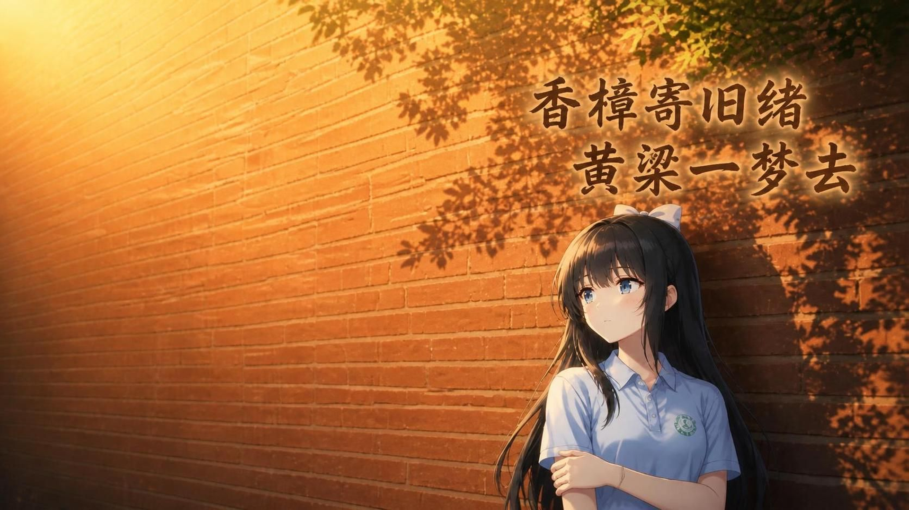

# 黄粱一梦

作为一名新踏入学校的高一新生，你在开学日早上冲进校门，撞倒了一个女生，她的一串手链留在了你手里，你也因此与这位神秘少女相识

于是你开始习惯放学后两人相伴的气息、食堂里的酸辣粉

你以为故事会这样继续下去，直到某天清晨……

这部作品凝结了我们众多心血，剧本、配音、美术与音乐皆由学生团队完成，谨将这段校园故事献给每一位游玩它的人

## 下载

请从 [Releases](releases/latest) 下载对应平台的包，包内附《使用说明》供首次安装的玩家参考

| 平台 | 文件 | 环境 |
| --- | --- | --- |
| Android | huangliangyimeng-1.0.4.apk | Android 5.0 及以上（鸿蒙 NEXT 不支持） |
| Windows | SLFGgal-1.0.4-pc.zip | Windows 10/11（64 位） |
| macOS | SLFGgal-1.0.4-mac.zip | macOS 10.14 及以上 |

## 预览

## 制作

编剧：戴文远 · 美术：冯骏骁 · 配音：陈煜枫 · 音乐：杨洛嘉 · 制作：李耔成 · 摄影：丁梓城

特别鸣谢：奚萌玥、唐圣涵

## 分发规则

完全免费、无内购的非商业学生作品。允许免费分享官方网盘链接与 Releases 原始包；完整条款见 [开源与分发规则](LICENSE.md)，《免责说明》随《使用说明》在网盘分发

## 联系与反馈

邮箱 zeason126@126.com · [GitHub Issues](issues)

## 更新日志

见各版本 [Releases](releases/latest) 说明

## 支持

以上内容由我个人整理。如希望支持我，请填写我的个人作业问卷：https://v.wjx.cn/vm/YTJnoAE.aspx# ，或将此游戏分享给更多人
